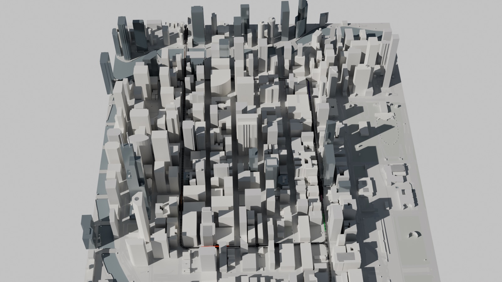
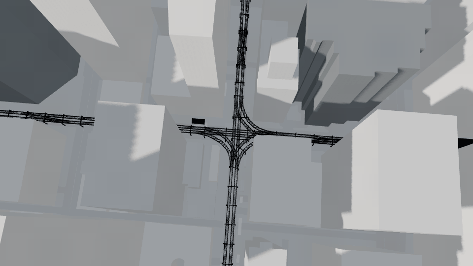
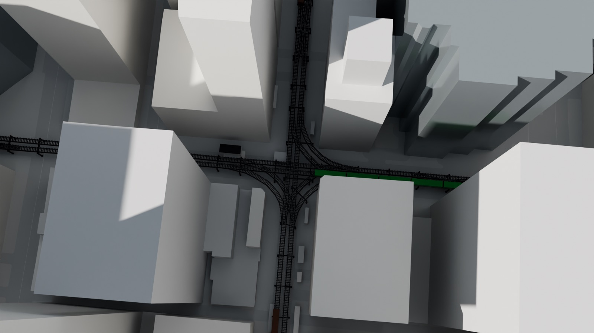
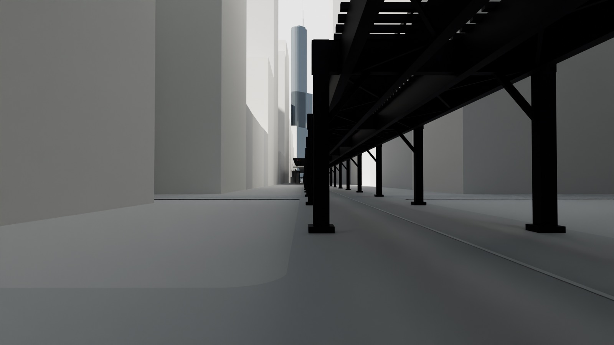
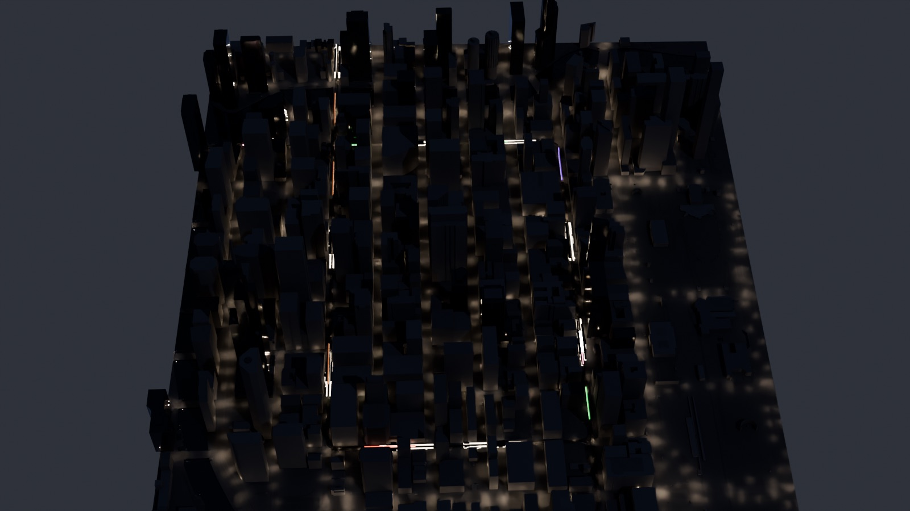
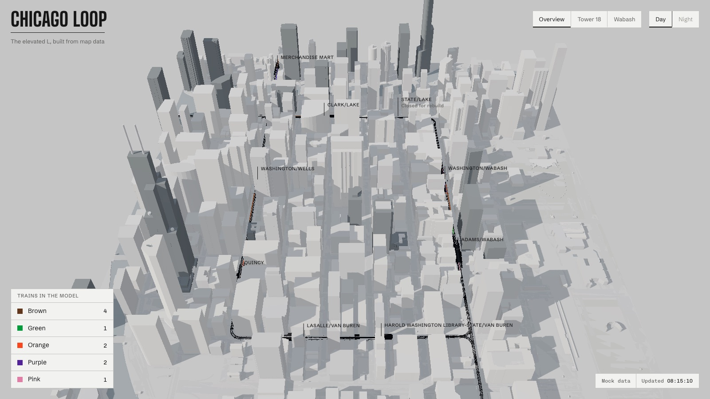

# Chicago Loop

A 1:1 model of the Chicago Loop as it stands today, built in Blender from OpenStreetMap and City of Chicago data, with the elevated L integrated: the real track geometry, the Tower 18 junction at Lake and Wells, and the eight Loop stations. A web viewer loads the model and moves Brown, Green, Orange, Pink and Purple Line trains around it.



Trains are simulated until there is a CTA Train Tracker key. The mock answers in the exact format of CTA's Locations API, on the real paths and believable timetables, so switching to live positions is one setting.



| | |
| --- | --- |
|  |  |
|  |  |

## Run it

The viewer needs Node 22.18 or newer:

```sh
npm install
npm run dev
```

Open http://localhost:5173/ for the landing page, or http://localhost:5173/viewer.html for the viewer. To see a busy rush hour at any time of day: `viewer.html?t=2026-10-13T08:15:00-05:00`.

Rebuilding the data and the model needs Python 3.11 through `uv`:

```sh
./scripts/setup.sh                         # .venv with bpy 5.0.1 and the pipeline dependencies
./scripts/build-data.sh                    # data/ downloads, build/loop.json, docs/data-report.md, mock/data/network.json
.venv/bin/python blender/build_loop.py     # build/renders/*.png, build/loop.glb, build/loop.blend
npm run sync-model -w web                  # copy build/loop.glb into the viewer
```

Checks:

```sh
npm test && npm run lint                   # Vitest, ESLint, TypeScript
.venv/bin/python -m pytest && .venv/bin/ruff check pipeline tests blender
```

## How it works

1. **Data** (`pipeline/`, Python). Downloads the OpenStreetMap extract of the Loop plus one block on every side, the City of Chicago building footprints and the CTA stop list. Projects everything to meters from State and Madison, x east, y north. Buildings get their OSM height, or a floor count at 3.9 m per floor, with every estimate flagged. Each line's path comes from the OpenStreetMap route relations, which is how the model knows Brown runs counterclockwise on the Outer Loop and Orange, Pink and Purple clockwise on the Inner Loop. Output: `build/loop.json`, checked by `pipeline/validate.py` and summarised in [docs/data-report.md](docs/data-report.md).
2. **Model** (`blender/`, bpy). A massing model in warm white and pale grey with glass only where the data says so, and the L in black steel: rails, ties, girders, bracing, column bents, the Tower 18 junction, platforms, canopies, stairs and line signs. Renders day and night stills and exports a 2 MB Draco glTF. See [blender/README.md](blender/README.md).
3. **Trains** (`mock/`, TypeScript). A deterministic simulator of the whole Brown, Green, Orange, Pink and Purple lines: trips leave their terminals on weekday headways, accelerate, brake, dwell at every station and pass through State/Lake, which is closed for its rebuild. It answers `ttpositions.aspx` in the documented JSON. See [docs/cta-api.md](docs/cta-api.md).
4. **Viewer** (`web/`, Vite and three.js). Snaps every reported train to its line's track in the direction it is heading, glides it along the track between updates, and draws its cars on the curves. Orbit, Tower 18 and a street level walk on Wabash; hover or tap a train for its run, destination and next station. See [web/README.md](web/README.md).
5. **Proxy** (`proxy/`, Cloudflare Worker, not deployed). Adds the CTA key from a secret so it never reaches the browser.

## Going live

1. Get a free Train Tracker key at transitchicago.com/developers.
2. Deploy the Worker: in `proxy/`, set `ALLOWED_ORIGIN`, then `npx wrangler secret put CTA_TRAIN_TRACKER_KEY` and `npx wrangler deploy`.
3. Build the viewer with `VITE_TRAIN_SOURCE=live` and `VITE_TRAIN_PROXY_URL` set to the Worker's URL.

## What is real and what is estimated

Real data: building footprints and most heights, track geometry, junctions, station and platform locations, canopy outlines, street entrances, line paths and stops, stop ids, line colors, the Train Tracker response format.

Estimated and marked as such: 1,016 of 1,214 building heights (floor counts, defaults for canopies and kiosks), the height of the L structure and its members, column spacing, State/Lake's platforms (removed from the map during the rebuild), and in the mock the headways, speeds, dwell times, run numbers and delays. Progress and decisions are logged in [docs/PROGRESS.md](docs/PROGRESS.md).

## Data credits

- Map data &copy; [OpenStreetMap](https://www.openstreetmap.org/copyright) contributors, available under the Open Database License.
- Building footprints: [City of Chicago Data Portal](https://data.cityofchicago.org/), Building Footprints.
- Station and stop ids: Chicago Transit Authority, CTA System Information: List of L Stops, via the City of Chicago Data Portal.
- Train Tracker API format: [CTA Developer Center](https://www.transitchicago.com/developers/ttdocs/). This project is not affiliated with or endorsed by the CTA.
