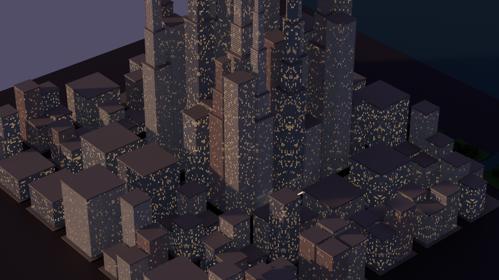

# Chicago Loop

A 1:1 model of the Chicago Loop built in Blender from real map data, with the elevated L and its eight Loop stations. A web viewer shows where CTA trains are on the Loop right now.

Work in progress. See `docs/PLAN.md` for the plan and `CLAUDE.md` for how the project is put together.



## Getting started

```sh
./scripts/setup.sh
.venv/bin/python blender/prototype_city.py 24 build/preview.png
```
