<h1 align="center">Chicago Loop</h1>

<p align="center">
  A 1:1 model of downtown Chicago and the elevated L, built from open map data,<br />
  with every Brown, Green, Orange, Pink and Purple Line train moving on the real track.
</p>

<p align="center">
  
  
  
  
</p>

<p align="center">
  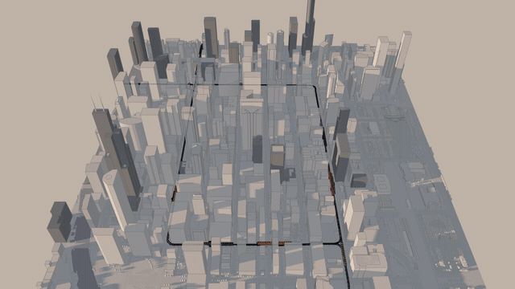
</p>

<p align="center"><sub>Late afternoon to night in about ten seconds. The light follows the real sun over the Loop; windows, streets and trains light up as it sets.</sub></p>

---

## What it is

The Loop as it stands today, block by block: 1,214 buildings from OpenStreetMap and the City of Chicago, the elevated L on its real track geometry, the Tower 18 junction at Lake and Wells, and all eight Loop stations. On top of it, the trains, placed where the CTA's Train Tracker says they are.

There is no Train Tracker key yet, so the trains come from a simulator that answers in the exact format of CTA's API, on the real routes, with real stops, weekday headways and signal spacing. Going live is one setting.

```sh
npm install
npm run dev        # http://localhost:5173
```

The model ships with the repository. No Blender, no Python and no API key are needed to run it.

## A tour

### Every train, from any height

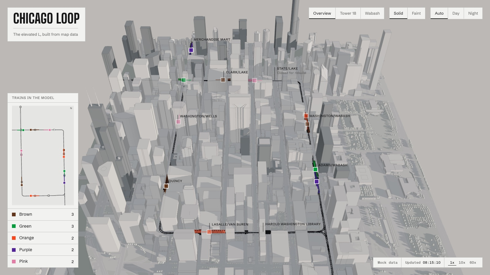

Each train is drawn car by car, each car resting on its two trucks, so trains bend through the curves. A marker in the line's color sits over every train, points the way it runs and stays visible when a building is in the way. The plan at the left shows the whole Loop live, with the area the camera sees.

<table>
  <tr>
    <td width="50%">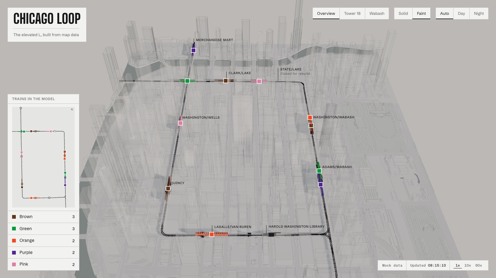</td>
    <td width="50%">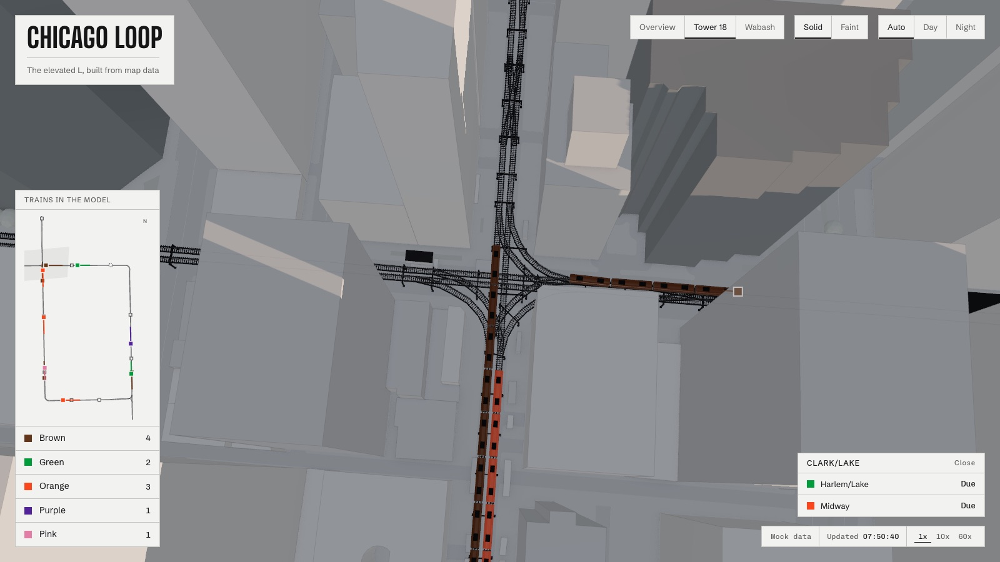</td>
  </tr>
  <tr>
    <td><sub><b>Faint.</b> One click turns the city to glass and leaves the L.</sub></td>
    <td><sub><b>Stations.</b> Click a station for the trains on their way, soonest first.</sub></td>
  </tr>
</table>

### Tower 18, live

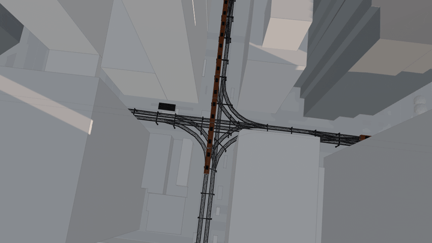

All five Loop lines pass through the junction at Lake and Wells, where the Loop meets the North Side Main Line and the Lake Street line. The simulator dispatches trains the way the interlocking does: they take turns through the junction and never run into each other.

### Follow a train

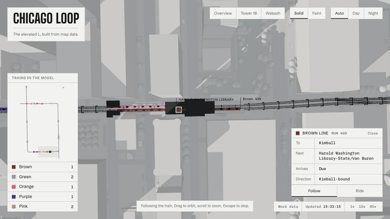

Select any train to see its run, destination, next stop and arrival. **Follow** keeps it in view from above, rising over buildings that would hide it. **Ride** puts you at the front.

### The Loop after dark

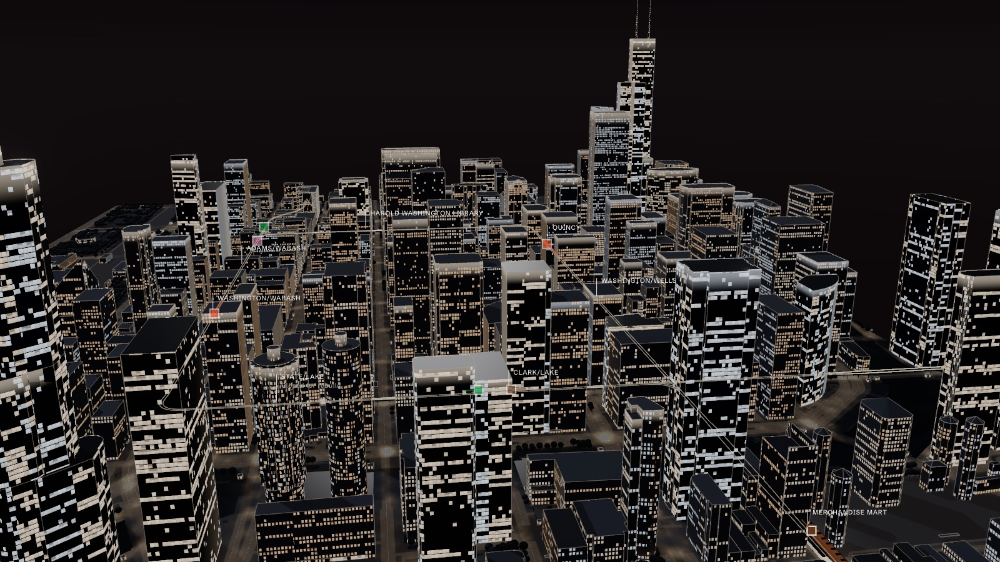

Night is made the way the Loop actually looks: office towers lit floor by floor, a few stray windows on the dark floors, lobbies glowing at street level, one light color per facade (cool white on the glass towers, warm in the masonry ones), floodlit crowns on the tall towers. How many floors are lit follows the hour: busy at six, quiet at three.

<table>
  <tr>
    <td width="50%">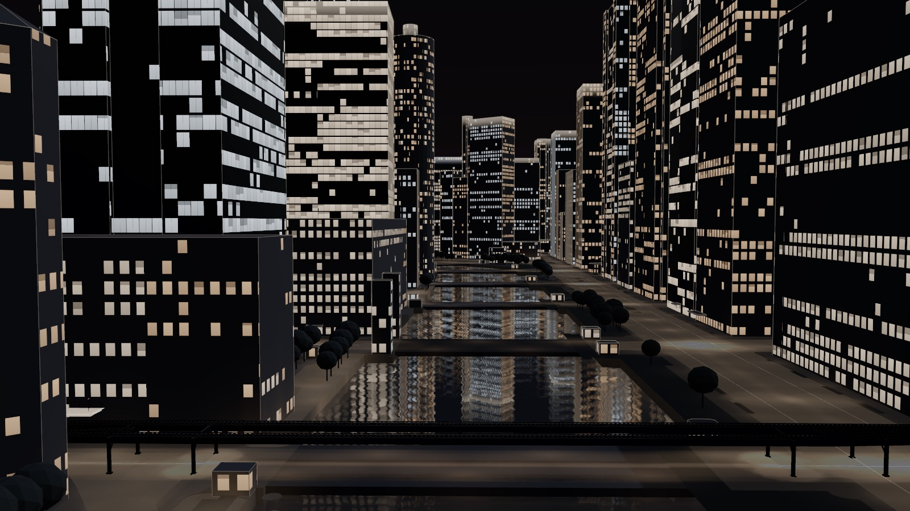</td>
    <td width="50%">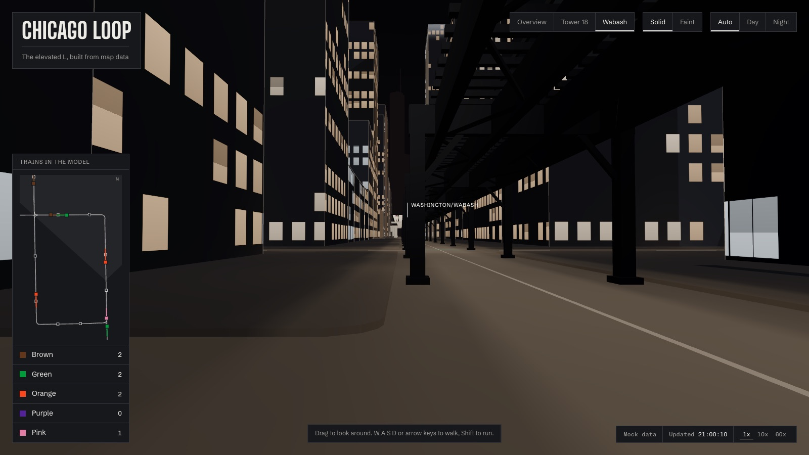</td>
  </tr>
  <tr>
    <td><sub><b>The river</b> reflects the city, with ripples and the long streaks lights leave on moving water.</sub></td>
    <td><sub><b>Wabash at street level.</b> Walk under the L with W A S D.</sub></td>
  </tr>
</table>

### Any hour

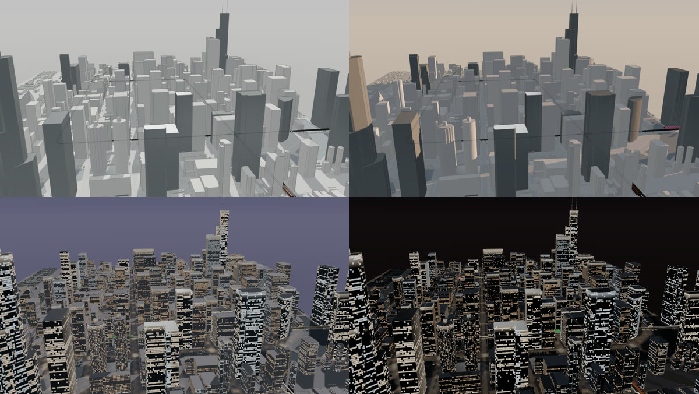

The light is computed for the moment on screen from the sun's real position over the Loop, and moves through golden hour, the blue hour and night without a cut. Set any moment with `?t=` and run the clock up to 60 times faster.

### On a phone

<p align="center">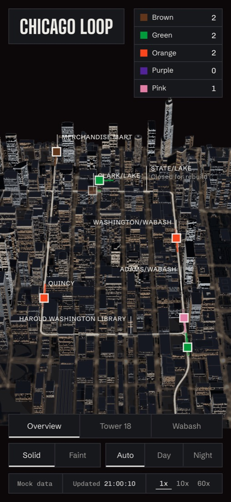</p>

## Rendered in Blender

The same model, rendered with Cycles for stills: the real Loop geometry, the L's steel down to the girders and bracing, and the night built on the same rules as the viewer.

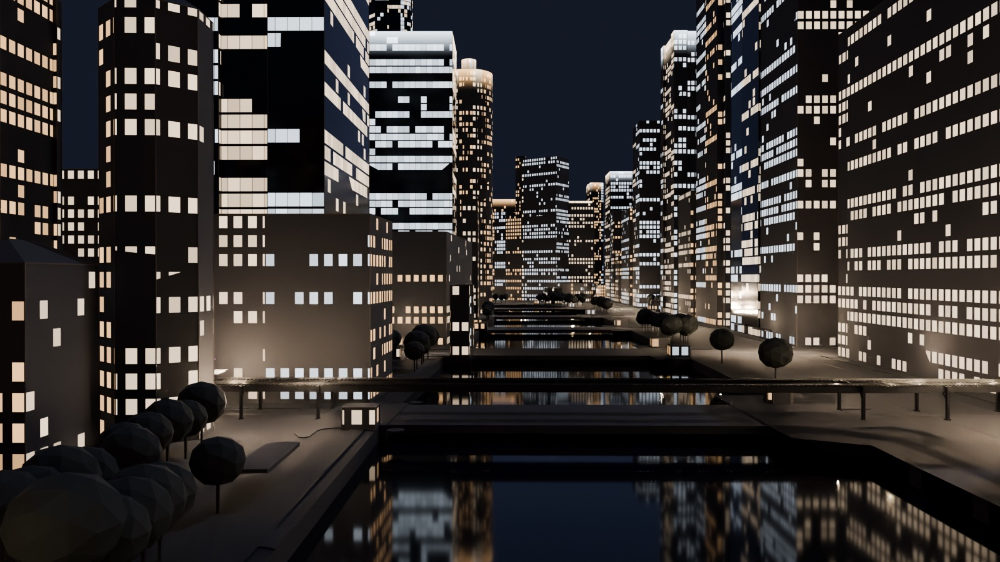

<table>
  <tr>
    <td width="50%">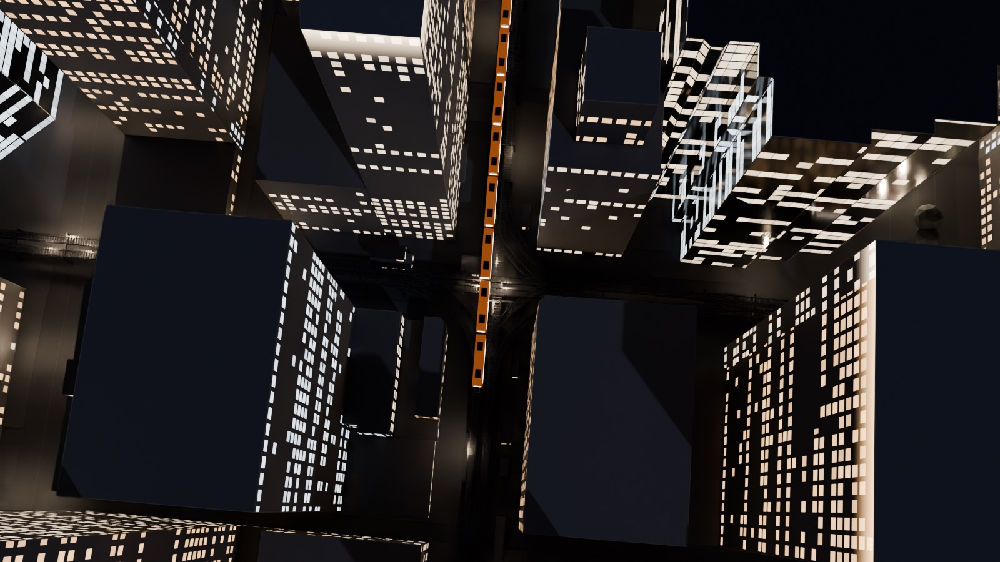</td>
    <td width="50%">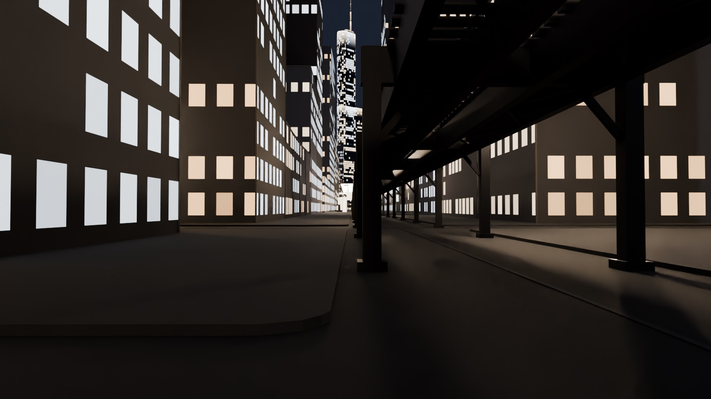</td>
  </tr>
</table>

## How it works

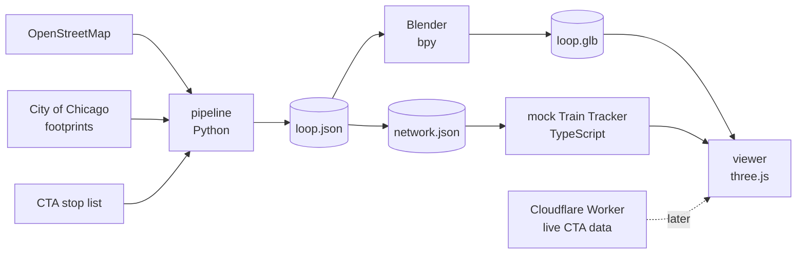

| Part | What it does |
| --- | --- |
| [`pipeline/`](pipeline) | Downloads OpenStreetMap, City of Chicago footprints and the CTA stop list for the Loop plus a block on each side, projects everything to meters from State and Madison, resolves building heights (measured where the data has them, from floor counts where it does not, every estimate flagged) and reads each line's path and stops from the OpenStreetMap route relations. Validated, and summarised in [docs/data-report.md](docs/data-report.md). |
| [`blender/`](blender) | Builds the scene with Blender as a Python module: massing with real roof shapes, the L structure, stations with platforms, canopies and stairs, the river, streets with curbs, trees. Renders the stills and exports a 2 MB Draco glTF. See [blender/README.md](blender/README.md). |
| [`mock/`](mock) | A deterministic simulator of the five lines in the exact JSON of CTA's Locations API: trains accelerate, brake, dwell, keep signal spacing and take turns through Tower 18 and Tower 12. See [docs/cta-api.md](docs/cta-api.md). |
| [`web/`](web) | The viewer: three.js with its own light model, shader-drawn windows and street light, a reflecting river, and instanced trains snapped to the right track and eased along it. See [web/README.md](web/README.md). |
| [`proxy/`](proxy) | A Cloudflare Worker that adds the CTA key from a secret, so it never reaches the browser. Written, not yet deployed. |

## Controls

| | |
| --- | --- |
| Drag, scroll | Orbit, zoom toward the pointer |
| Double-click | Fly to that spot |
| `W` `A` `S` `D`, arrows | Pan (walk on Wabash), Shift for faster |
| `Q` `E`, `+` `-` | Turn, zoom |
| `1` `2` `3` | Overview, Tower 18, Wabash |
| `F`, `R` | Follow or ride the selected train |
| `B`, `N` | Faint buildings, day and night |
| `Esc` | Step back |

Every view is a link: the address bar keeps the camera preset, light, building mode and selected train or station, for example `?view=tower18&buildings=faint&train=org:709`.

## Run and rebuild

```sh
npm install && npm run dev                  # the viewer, with simulated trains
npm test && npm run lint                    # Vitest, ESLint, TypeScript
```

Rebuilding the data and the model needs Python 3.11 through [uv](https://docs.astral.sh/uv/):

```sh
./scripts/setup.sh                          # .venv with bpy 5.0.1 and the pipeline dependencies
./scripts/build-data.sh                     # downloads, build/loop.json, data report, network for the mock
.venv/bin/python blender/build_loop.py      # renders, build/loop.glb
npm run sync-model -w web                   # copy the model into the viewer
```

### Going live

1. Get a free Train Tracker key at [transitchicago.com/developers](https://www.transitchicago.com/developers/).
2. In `proxy/`, set `ALLOWED_ORIGIN`, then run `npx wrangler secret put CTA_TRAIN_TRACKER_KEY` and `npx wrangler deploy`.
3. Build with `VITE_TRAIN_SOURCE=live` and `VITE_TRAIN_PROXY_URL` set to the Worker's URL.

## What is real and what is estimated

**From the data:** building footprints, 198 measured heights, the track geometry and junctions, stations, platforms, canopies and entrances, each line's path and stops, CTA stop ids, line colors, 3,076 trees, the streets, the river and the Train Tracker format.

**Estimated, and marked as such:** 1,016 building heights from floor counts at 3.9 m per floor, roof heights where missing, the L structure's dimensions, State/Lake's platforms (the station closed in January 2026 for a rebuild expected to last until 2029; trains pass through), and in the simulator the headways, speeds, dwell times and run numbers. The night is a reading of how the Loop looks, not measured light. Details in [docs/data-report.md](docs/data-report.md) and [docs/PROGRESS.md](docs/PROGRESS.md).

## Credits

- Map data &copy; [OpenStreetMap](https://www.openstreetmap.org/copyright) contributors, under the Open Database License.
- Building footprints: [City of Chicago Data Portal](https://data.cityofchicago.org/).
- Station and stop ids: Chicago Transit Authority, via the City of Chicago Data Portal. Train Tracker format from the [CTA Developer Center](https://www.transitchicago.com/developers/ttdocs/). Not affiliated with or endorsed by the CTA.
- Type: Big Shoulders Display (made for the City of Chicago), Schibsted Grotesk, Chivo Mono.
